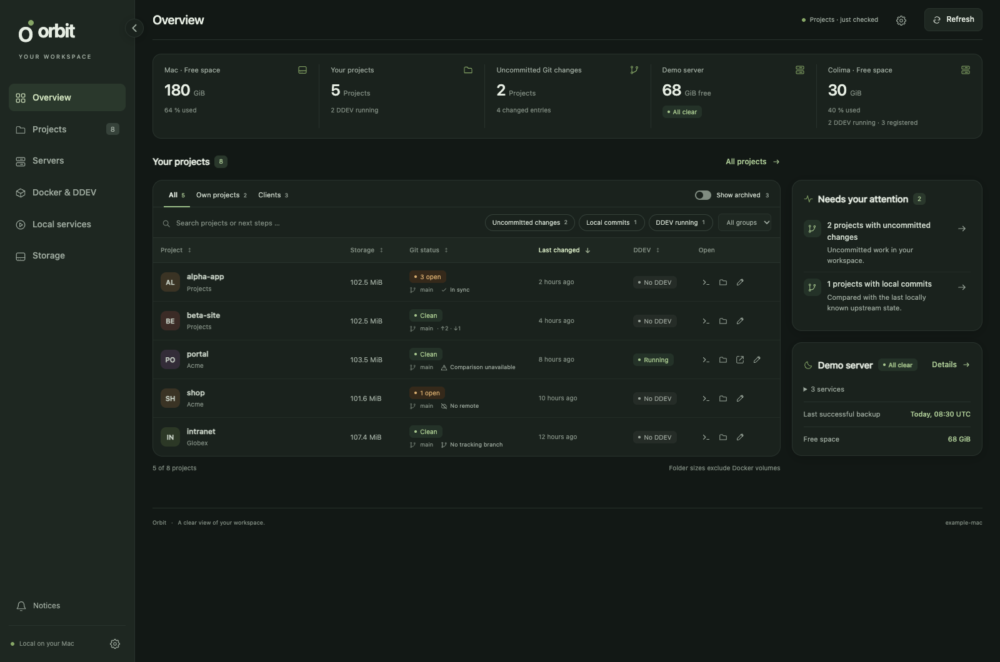
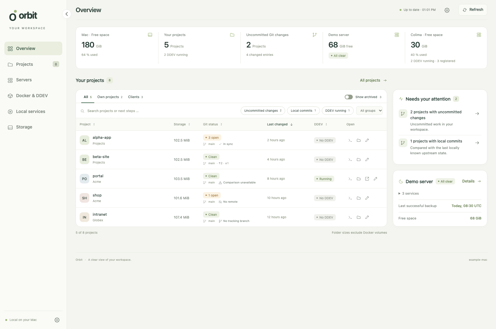
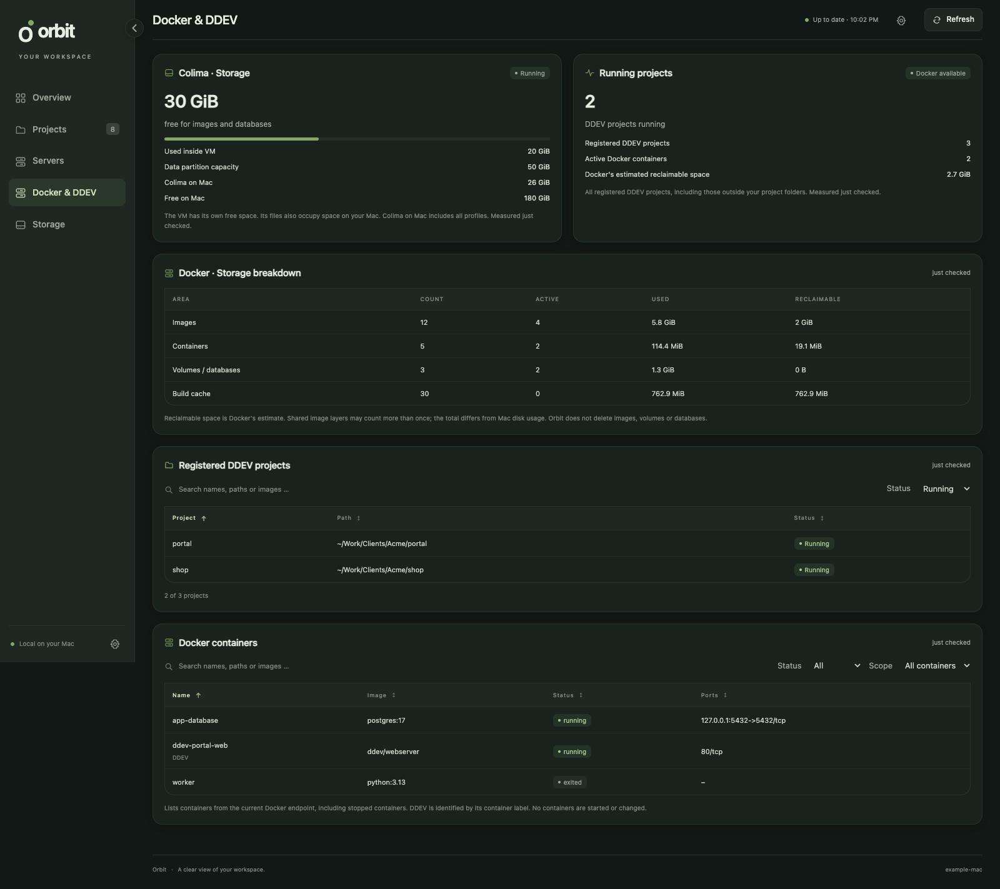
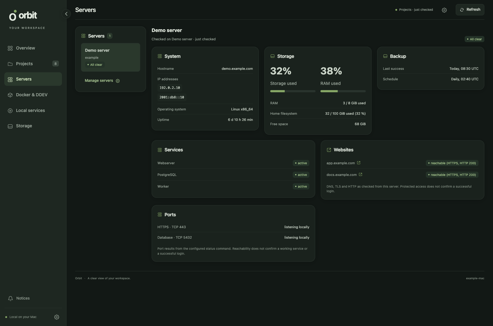

# Orbit Dashboard

A local dashboard for your development workspace. See your projects, Git changes,
container status and available storage in one place, then open the project you need.

Orbit runs on your Mac. No account, cloud service or frontend build step.
Python's standard library powers the backend; a small Swift app provides the native window.



*Screenshots use a synthetic workspace. No personal projects, server data or credentials.*

## What you get

- **Projects and Git.** Search, sort and filter projects across your folders. See
  uncommitted work, branches and local commits without fetching or changing repositories.
  Open the Git status window to switch between changed files and the latest ten commits.
- **Your next step.** Optional notes, priorities and archive states. Choose which
  table columns you want; paths shorten in the middle and timestamps show relative time.
- **Docker and DDEV, when you use them.** Filter and sort registered DDEV projects.
  List Docker containers independently, including databases outside DDEV. Keep the
  storage breakdown beside them.
- **Local background services.** Opt in under Tools to list launchd definitions and
  accessible cron jobs. Filter by origin, user/system scope and status; mark your own
  services, add descriptions and pin favorites to Overview. Service checks change no jobs.
- **Storage.** Mac disk space, local project sizes and storage history. Colima figures
  distinguish VM capacity from space occupied on your Mac.
- **Optional servers.** Multiple SSH connections with separate overview visibility.
  Opt in to read-only system queries without installing anything on the server,
  use an existing status command, or combine both.
- **Optional GoAccess reports.** Download prepared website reports over SSH.
  Configure the read-only export in Settings → Tools. No tracking script or server
  changes are made by Orbit. See [the integration guide](docs/goaccess.md).
- **An interface you can adjust.** Light, dark and system appearance, five palettes,
  compact or comfortable spacing, font size, contrast and zoom. A collapsible sidebar.

Filters and sorting are remembered locally by default, separately for Overview and Projects.
Turn this off in Appearance.
Search text is never saved; Reset filters clears the current view’s filters and keeps its sorting.

English is the default; German is available in Settings. Your project names, paths,
categories and notes keep their own language.

## Quickstart

This is a **macOS source distribution**. You need Python 3.10 or newer and Git for
Git status. Docker, DDEV, Colima and SSH are optional. The native window also needs
Apple Command Line Tools. Node.js is only needed for frontend development checks.

Download the [Developer Preview](https://github.com/morja/orbit-dashboard/releases/tag/v0.1.0-preview.3)
or clone the [repository](https://github.com/morja/orbit-dashboard):

```sh
git clone https://github.com/morja/orbit-dashboard.git
cd orbit-dashboard
```

For a release ZIP, extract it and open a terminal in the extracted folder.

### Native Mac app

```sh
python3 --version
xcrun --find swiftc
python3 macos/build.py
open -a "Orbit Dashboard"
```

The build installs `~/Applications/Orbit Dashboard.app`. Keep the source folder and
Python interpreter in place; the app uses both. Rebuild after moving the source.
This is a locally built app, not a portable notarized download.

### Browser mode

```sh
python3 server.py
```

Open the local address printed in the terminal. It includes the key needed to save
settings. Stop the backend with Ctrl+C. Alternatively, double-click `Orbit.command`
to launch a background backend and open the browser.

### Make it your workspace

1. Open **Settings → Project folders → Detect environment**. Select the folders
   you want Orbit to read, or add them yourself. Fresh installations scan nothing.
2. In **Tools**, enable the integrations you actually use. In **Appearance**, choose
   your theme, density and visible project columns.
3. Save. Projects appear as the first check completes. Servers stay disabled until
   you deliberately configure and enable them.

No personal paths or server connections are included in the defaults. Settings,
notes, measurements and cached results stay in the local `data/` folder.

## Let your AI set it up

Open the unpacked source folder in your coding assistant and paste this prompt:

```text
Set up Orbit Dashboard for me on this Mac using the source in this folder.

Read AGENTS.md and docs/ai-setup.md first. Inspect existing changes and preserve
my settings, notes and any manually edited files. Keep the current design.
Use English as the default interface language.

Check Python 3.10+ and the tools needed for the native Mac app. Explain missing
prerequisites before installing anything. If the native build is unavailable,
use browser mode and explain how to start and stop it.

Use Orbit's environment detection to suggest project folders and installed tools.
Ask me which folders to include and about any uncertain category or group choices.
Do not scan my entire home directory. Store choices in local settings and validate
them with orbit_config.validate, or save them through the app's Settings API.
Do not hardcode my paths or preferences into the source.

Enable only the optional integrations I choose. Ask explicitly before activating
SSH queries. Do not install remote scripts, change server services, start or stop
containers, or fetch, pull, commit or push any of my project repositories.

Build and open Orbit if the prerequisites are available. Verify that my selected
projects appear, settings survive reopening, unavailable tools are explained,
and the native app stops its owned backend when closed. Keep the design intact.
Report how to launch Orbit and any remaining setup steps. Do not expose keys,
credentials, personal notes or databases in your response or in Git.
```

Everything configured by the assistant remains editable in the app. For manual
configuration, start from [`config.example.json`](config.example.json) and the
[setup guide](docs/ai-setup.md).

## A closer look







## Local data and read-only checks

Orbit binds to `127.0.0.1`. The interface uses no external fonts, analytics or APIs.
Notes and settings require a local action key. Read-only dashboard data is available
to other local processes, so Orbit is intended for your own trusted user environment.

Collectors read project metadata and file timestamps. They do not run project code
or mutate Git repositories. Docker checks do not start, stop or delete containers.
SSH system queries are off by default, require existing trusted access and run no
more often than every five minutes. They create no remote files and use no sudo.

Project sizes include dependencies and Git files, but exclude Docker volumes.
“Last changed” uses the newest source-file modification or commit; automatic writes
can count too, while dependency/build folders, Git metadata and `.log` files are excluded.
A reported backup success is not a restore test.

See the [reference](docs/reference.md) for measurement scope, refresh intervals,
native lifecycle, autostart and troubleshooting. Custom status commands currently
use the documented [Moon-compatible adapter](docs/ai-setup.md#server-status-adapter-and-its-current-limits).
Automatic SSH system collection does not need that adapter; it primarily targets Linux servers.

## Development

```sh
python3 -m unittest discover -s tests -v
npm run check
npm install
npx playwright install chromium
npm run test:browser
```

Tests use synthetic workspaces and never need your projects or an SSH connection.
See [CONTRIBUTING.md](CONTRIBUTING.md), the [frontend structure](docs/frontend.md)
and the [technology decision](docs/technology.md). Screenshot generation is described
in [docs/screenshots/README.md](docs/screenshots/README.md).

## Release status and license

[Developer Preview v0.1.0-preview.3](https://github.com/morja/orbit-dashboard/releases/tag/v0.1.0-preview.3)
is a macOS source release, available under MIT. This repository starts with a clean
source snapshot and fresh history. It includes no personal settings or workspace data.
The native setup still needs validation on a second Mac. Signed standalone downloads
and Windows/Linux desktop packages are future work.

[MIT License](LICENSE). See [the release checklist](docs/release-checklist.md)
and [the readiness review](docs/release-readiness.md).
